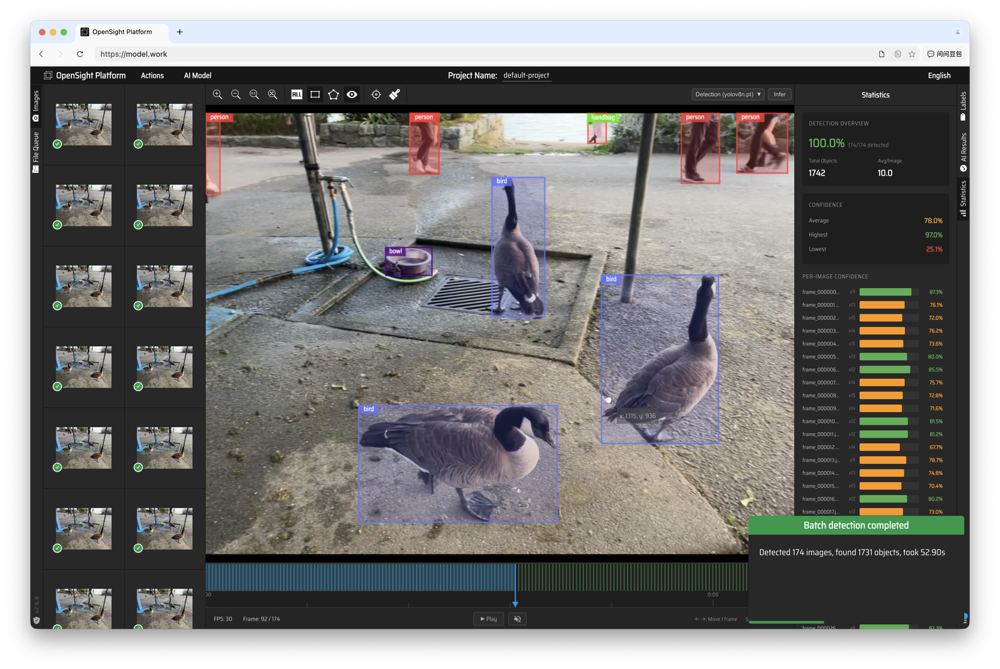

# OpenSight

[中文](README.md) | **English**

An intelligent visual-data annotation and edge-compute control platform covering annotation, inference, datasets, training, retrieval, and node-resource management.

[Live Demo](https://model.work/) · [Issues](https://github.com/quest-X/model-work-frontend/issues) · [Releases](https://github.com/quest-X/model-work-frontend/releases)

整理日期：2026-10-23。仅调整文档表达与分卷；原有授权、事实日期和验收边界保持原范围。

其他分卷：[2. Repository Role](<README_EN(1).md>)；[3. Development and Verification](<README_EN(2).md>)。
